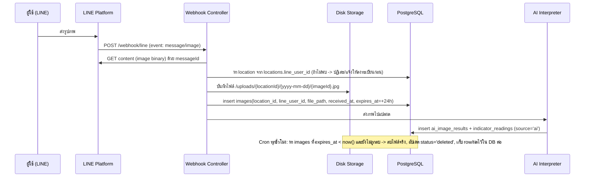

# Architecture — ระบบรายงานคุณภาพน้ำและแผนที่แสดงผลเชิงพื้นที่

อ้างอิงจาก TOR (งบ 50,000 บาท / 60 วัน) เลือก stack ที่ง่าย ต้นทุนต่ำ ติดตั้ง/ดูแลง่าย เพื่อให้ทำ MVP ทันกำหนดและงบ

## 1. Tech Stack

| Layer | เลือกใช้ | เหตุผล |
|---|---|---|
| Frontend | React (Vite) + TailwindCSS | เร็ว ทำ UI/Map/Dashboard ได้ในเวลาจำกัด |
| Map | Leaflet.js + OpenStreetMap tiles | ไม่มีค่าใช้จ่าย/ไม่ต้องขอ API Key เหมือน Google Maps, รองรับ custom image marker ได้ดี |
| Backend | Node.js + Express (REST API) | นิยม หา dev ง่าย, ไลบรารีเชื่อม LINE SDK พร้อมใช้ (`@line/bot-sdk`) |
| Database | PostgreSQL | รองรับ JSONB (เก็บผลตอบ AI แบบดิบ), ความสัมพันธ์ข้อมูลชัดเจน, ขยายเป็น PostGIS ได้ในอนาคตหากต้องคำนวณเชิงพื้นที่เพิ่ม |
| Auth | JWT + bcrypt | Stateless, ไม่ต้องมี session store เพิ่ม |
| File storage | Local disk (`/uploads/{locationId}/{yyyy-mm-dd}/`) | พอสำหรับ prototype งบจำกัด, โครงสร้าง path ออกแบบให้ย้ายขึ้น S3-compatible ได้ในอนาคตโดยไม่กระทบ schema |
| AI แปลผลภาพ | เรียกผ่าน external API (เช่น Claude Vision / Google Vision) ผ่าน interface กลาง `AIInterpreterService` | ไม่ล็อกกับ provider เดียว สวอปได้ถ้า provider เปลี่ยนราคา/เงื่อนไข |
| Job scheduler | `node-cron` ใน backend process เดียวกัน | ไม่ต้องมี infra แยก, พอสำหรับ job ลบไฟล์ทุก 24 ชม. |
| Deploy | Docker Compose (app + postgres) บน VPS เดียว | ต้นทุนต่ำ เหมาะกับงบ 50,000 บาท |

## 2. Component Diagram

```mermaid
flowchart TB
    subgraph Client
        WebApp[React SPA\n(Member Portal / Admin / Public Map)]
    end

    subgraph LINE
        LineOA[LINE Official Account]
    end

    subgraph Server["Backend (Node.js/Express)"]
        API[REST API]
        WebhookCtrl[LINE Webhook Controller]
        AuthSvc[Auth Service]
        AISvc[AI Interpreter Service]
        CronJob[Cron: Image Expiry Cleanup]
    end

    DB[(PostgreSQL)]
    Storage[(Local Disk /uploads)]
    AIProvider[[External AI Vision API]]

    WebApp -- HTTPS/JSON --> API
    API --> AuthSvc
    API --> DB
    LineOA -- Webhook (image event) --> WebhookCtrl
    WebhookCtrl --> Storage
    WebhookCtrl --> DB
    WebhookCtrl --> AISvc
    AISvc --> AIProvider
    AISvc --> DB
    CronJob --> Storage
    CronJob --> DB
    WebApp -- Leaflet tiles --> OSM[(OpenStreetMap)]
```

## 3. LINE Image Flow (Sequence)



## 4. Users vs. Locations vs. Teams — ทำไมต้องแยกเส้นทางกัน

ข้อมูลจุดตรวจวัด (`locations`) ถูกส่งเข้ามาผ่าน LINE OA โดย**ใครก็ได้** ไม่จำเป็นต้องมีบัญชีผู้ใช้บนเว็บ (`users`) จึงออกแบบให้:

- `users` และ `locations` เป็นตารางอิสระจากกัน ไม่มี 1:1 บังคับ
- **`teams` ผูกกับทั้ง `users` และ `locations` แยกเส้นทางกัน ไม่ไหลผ่านกัน:**
  - `locations.team_id` (nullable) — บอก "ทีม" ของหมุดนั้นสำหรับแสดงผลบนแผนที่/popup โดยตรง เพราะ TOR ข้อ 2.2 กำหนดให้ popup ต้องโชว์ชื่อทีมของ**ทุกหมุด** แม้หมุดนั้นไม่มี user ผูกอยู่เลยก็ต้องรู้ทีมได้ — ถ้าให้ team ไหลผ่าน `users` (`users→teams`, `locations→users`) หมุดที่ไม่มี user จะไม่มีทางรู้ทีม เพราะ FK chain ขาดตอน
  - `users.team_id` (nullable — สมัครก่อน แอดมินกำหนดทีมทีหลัง) — ใช้กำหนด**สิทธิ์แก้ไข**: member คนไหนก็ได้ในทีมเดียวกันแก้ไข location ที่ `team_id` ตรงกันได้ทั้งหมด ไม่ผูกกับ "เจ้าของคนเดียว"
- `locations.created_by_user_id` (nullable, ไม่ unique) — เก็บไว้เป็น **audit** เฉยๆ ว่า user คนไหน (ถ้ามี) เป็นผู้ลงทะเบียน/แก้ไขจุดนี้ล่าสุดทางเว็บ ไม่ใช่ตัวตัดสินสิทธิ์
- การจับคู่รูปที่ส่งมาจาก LINE เข้ากับ location ที่ถูกต้อง ใช้ `locations.line_user_id` (ผูกไว้ล่วงหน้าต่อจุด) เป็น key — **ไม่เกี่ยวกับ `users` เลย**

```
teams ──o{ users           (สิทธิ์แก้ไข: users.team_id = locations.team_id)
teams ──o{ locations       (แสดงผล: team_name บน popup/map)
users ──o{ locations       (audit เท่านั้น: created_by_user_id)
```

## 5. Data Retention

- ไฟล์รูปต้นฉบับ (`images.file_path`) เก็บไว้สูงสุด **24 ชั่วโมง** หลังจากนั้น cron job จะลบไฟล์จริงออกจาก disk และตั้ง `images.status = 'deleted'`, `images.file_path = NULL`
- ผลการแปลผล (`ai_image_results`, `indicator_readings`) **ไม่ถูกลบ** ยังคงอยู่เพื่อใช้แสดงผลบนแผนที่/กราฟ

## 6. Role & Access

- `admin`: เข้าถึง/แก้ไขข้อมูล location ทั้งหมด (ทุกทีม), จัดการ indicator master data, กำหนด `team_id` ให้ user ที่สมัครเข้ามา, ดูภาพ/ผลทุกจุด
- `member`: แก้ไขได้เฉพาะ location ที่ `team_id` ตรงกับทีมของตนเอง (ตรวจสอบที่ application layer ตอน request ไม่ใช่ DB constraint) — ถ้า `users.team_id` ยัง null (รอแอดมินกำหนดทีม) จะยังไม่มีสิทธิ์แก้ไข location ใดได้

ดู ER diagram และ DDL เต็มใน [db/schema.sql](../db/schema.sql)
